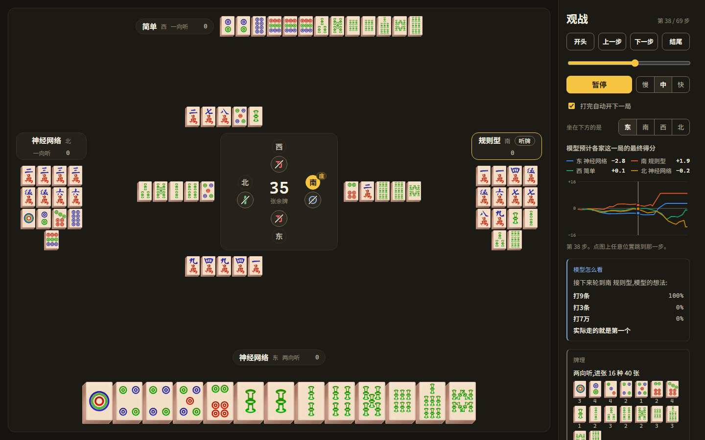
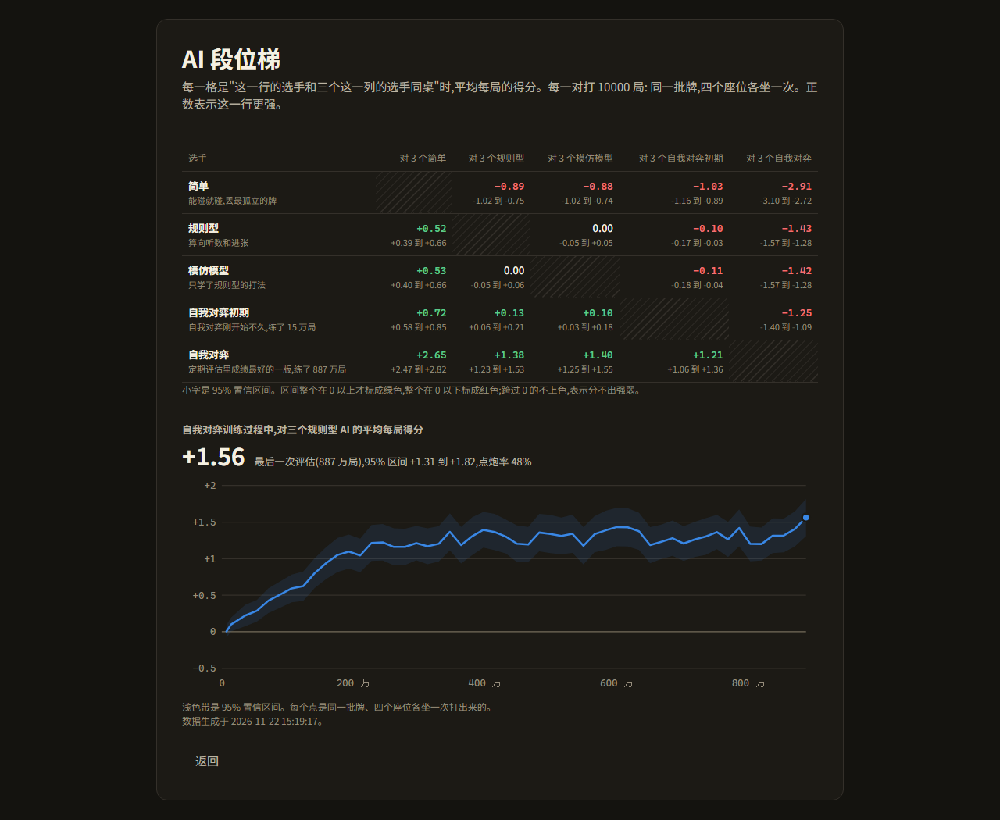
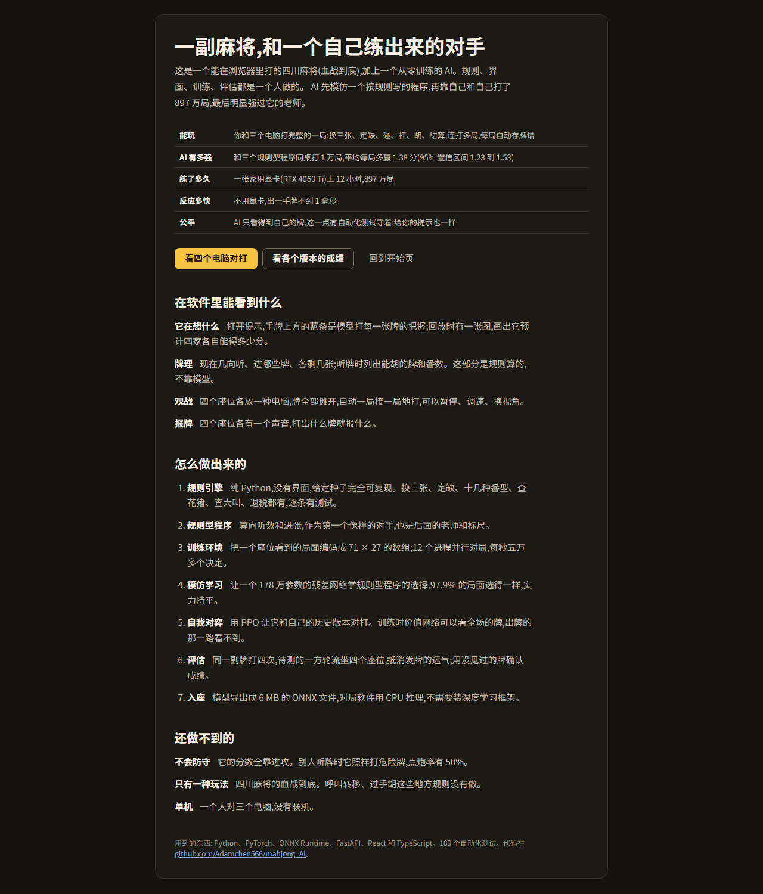

# Mahjong AI — 四川麻将(血战到底)

一个能在浏览器里打的四川麻将,加上一个从零训练出来的 AI。它先模仿一个按规则写的程序,再靠自己和自己打了 897 万局,最后明显强过它的老师。



| | |
|---|---|
| 能玩 | 你和三个电脑打完整的一局:换三张、定缺、碰、杠、胡、结算,连打多局,每局自动存牌谱 |
| AI 有多强 | 和三个规则型程序同桌打 1 万局,平均每局多赢 1.38 分(95% 置信区间 1.23 到 1.53) |
| 练了多久 | 一张 RTX 4060 Ti 上 12 小时,897 万局自我对弈 |
| 反应多快 | 不用显卡,出一手牌不到 1 毫秒 |
| 看得见它在想什么 | 手牌上的概率条、四家的估值曲线、四个电脑对打的观战、各个版本的段位梯 |
| 老实说的短板 | 防守偏弱:和三个规则型程序同桌时点炮率 50%,那三家是 45%。血战到底一局要胡三家,四家平均本来就在 46% 左右;只有血战到底一种玩法;单机,没有联机 |

| 各个版本两两对打,加训练曲线 | 软件里的项目介绍 |
|---|---|
|  |  |

启动软件后,地址后面加 `#watch`、`#ladder`、`#about` 可以直接打开观战、段位梯和项目介绍。

## 进度

| 目标 | 内容 | 状态 |
|---|---|---|
| 1. 可使用的麻将软件 | 浏览器里 1 人对 3 个电脑,完整打一局并结算 | **已完成(阶段 2)** |
| 2. 训练 AI | 规则型 AI 打底,再用自我对弈强化学习 | **已完成(阶段 4)**:先模仿规则型 AI(持平),再自我对弈 12 小时。自我对弈 887 万局后,对 3 个规则型 AI 打 1 万局没用过的牌,平均每局 +1.378 分(95% 置信区间 +1.230 到 +1.526) |
| 3. AI 加入对局 | 训练出的模型作为不同难度的对手坐进牌局 | **已完成(阶段 5、6)**:开始页可以选"神经网络"对手,入座的是自我对弈训出的模型;对局时有提示和牌理,回放时有逐步分析;还能看四个电脑对打、看各个版本的段位梯 |
| 地基:规则引擎 | 无界面、可复现的川麻状态机,三个目标共用 | 已完成(阶段 0、1) |

联机对战不在当前范围内。完整计划见 [docs/roadmap.md](docs/roadmap.md)。

## 日麻(立直麻将)

同一个软件里还有一套日麻,按天凤段位战的规则写,和川麻的代码互不依赖(引擎 `riichi/`、训练 `riichi_ai/`)。

| | |
|---|---|
| 能玩 | 1 人对 3 个电脑打东南战,赤宝牌、立直、副露、流局、点数和名次分;牌谱、观战、报牌人声和音效 |
| AI | 先模仿规则型程序(持平),再自我对弈 15 万场半庄(3.9 小时)。另一批 1200 场半庄里对 3 个规则型平均每场 +3.68 名次分(95% 区间 +1.88 到 +5.47) |
| 提示 | 模型首选的三个动作和概率、这一场的估值、每张牌打出去被荣和的概率("险") |
| 外部对照 | 接了开源最强的 Mortal(只在本机,AGPL 运行时不入库)。Mortal 对 3 个规则型 +14.7,我们的模型对 3 个 Mortal −11.4,差距主要在防守 |

规则见 [docs/riichi-rules.md](docs/riichi-rules.md),训练见 [docs/riichi-training.md](docs/riichi-training.md),Mortal 见 [docs/riichi-mortal.md](docs/riichi-mortal.md)。

## 打一局

第一次用之前装依赖、构建界面(只需一次):

```bash
pip install -r requirements.txt
```

```bash
cd frontend
```

```bash
npm install
```

```bash
npm run build
```

之后每次只要在项目根目录运行:

```bash
python -m server
```

浏览器会自动打开 `http://127.0.0.1:8000`。选对手水平,开一桌。

| 界面功能 | 说明 |
|---|---|
| 换三张 | 点三张同花色的牌,再点"换出这三张" |
| 定缺 | 三个按钮,各自标着你手里有几张 |
| 出牌 | 点一张牌选中,再点一次打出;不能打的牌会变暗 |
| 碰、杠、胡、过 | 能做的时候才出现按钮 |
| 结算 | 每局结束弹出记分单:谁胡了什么、每一笔分、累计分;可以收起来看四家摊开的牌 |
| 连打多局 | 轮流坐庄,累计积分;刷新页面会接着原来的牌局 |
| 牌谱 | 每局自动存到 `records/`;可以逐步回放,四家的牌都是明的 |
| 声音 | 出牌、摸牌、碰、杠、胡、一局结束各有音效;能碰杠胡时有提醒声。侧栏底部可以关,选择会记住 |
| 缺门 | 各家缺哪门用符号显示在牌桌中央:红色"万"、蓝色圆饼(筒)、绿色竹节(条),加一道斜杠 |
| 提示 | 侧栏底部打开后,轮到你时显示模型最看好的三个动作和各自的把握,手牌上用蓝色虚线框出它建议打的那张 |
| 回放分析 | 回放时显示模型在每一步会怎么走、和实际走的是否一样;可以直接跳到你和模型不同的地方 |
| 牌理 | 侧栏显示现在几向听、进哪些牌、各剩几张;听牌时列出能胡的牌、剩几张、几番。轮到你出牌时,每张牌上标着打出去之后的进张数。纯规则计算,不需要模型;侧栏底部可以关 |
| 危险度 | 轮到你出牌时,点炮可能在 8% 以上的牌标"险"和百分比;选中一张能看到对哪几家各有多大可能。按 4 万局电脑对局统计,不靠模型 |
| 概率条 | 打开提示后,手牌上方的蓝色竖条是模型打出每一张牌的概率 |
| 估值曲线 | 回放和观战时,侧栏有一张图:模型预计四家各自这一局的最终得分,随牌局进行怎么变。点图上任意位置跳到那一步 |
| 观战 | 开始页"看电脑对打":四个座位各选一种电脑,牌全部摊开,自动一局接一局地打;可以暂停、调速、换视角 |
| 段位梯 | 开始页"AI 段位梯":各个版本两两同桌对打的成绩表,加上训练过程的成绩曲线 |
| 项目介绍 | 开始页"关于这个项目":做成了什么、怎么做出来的、还做不到什么 |
| 报牌 | 四个座位各有一个人声,打出什么牌就报什么,碰、杠、胡、自摸也会喊。侧栏底部可以单独关 |

| 启动参数 | 作用 |
|---|---|
| `--port 9000` | 换端口 |
| `--delay 0.3` | 电脑每步之前停顿几秒(默认 0.7) |
| `--no-browser` | 不自动打开浏览器 |
| `--seed 1` | 固定发牌,调试用 |

## 电脑对手

| 名称 | 打法 | 实力 |
|---|---|---|
| 简单 `simple` | 能胡就胡、能碰杠就碰杠,丢最孤立的牌 | 基准 |
| 规则型 `rule` | 算向听数和有效进张,只在有用时碰牌,听牌时选剩余张数 × 得分最大的听法 | 对 3 个"简单":每局平均多赢 0.72 分(95% 置信区间 +0.52 到 +0.91,4800 局同牌对比),胡牌率 79% |
| 神经网络 `net` | 训练出来的模型(`models/chuanma.onnx`),在 CPU 上出一手牌不到 1 毫秒。只看得到自己座位的信息 | 对 3 个"规则型"1 万局:平均每局 +1.378 分(+1.230 到 +1.526)。对 3 个"简单":+2.646。进攻强,但不会防守:点炮率 50% |

比较两个策略:

```bash
python -m ai.evaluate --candidate rule --baseline simple -n 1000 --workers 12
```

同一副牌打 4 次,待测策略轮流坐 4 个座位,抵消发牌运气。

## 训练环境

给神经网络训练用的部分(需要 numpy 和带 CUDA 的 PyTorch,安装方法见 `requirements-train.txt`)。逐项任务和进度见 [docs/phase4-tasks.md](docs/phase4-tasks.md)。

| 工具 | 作用 |
|---|---|
| `ai/encoding.py` | 把一个座位看到的局面编码成 71 × 27 的数组,外加 115 个动作的合法掩码 |
| `ai/env.py` | 多进程并行对局:每一步交出一批待决策的局面,收回一批动作 |
| `python -m ai.generate` | 让规则型 AI 互打,把每个决策点存成模仿学习的数据 |
| `python -m ai.bench` | 测上面这些的速度 |
| `python -m ai.train_bc` | 模仿学习:让网络学规则型 AI 的选择 |
| `ai/net_agent.py` | 把训练出的网络包成可以入座的策略;`ai.evaluate` 的 `--candidate` 可以直接给模型文件 |
| `python -m ai.ladder` | 各个版本两两对打,生成段位梯页面的数据 `models/ladder.json` |

生成 1 万局的模仿数据(约 80 秒,37 MB):

```bash
python -m ai.generate --games 10000 --workers 12 --out data/bc_rule
```

训练模仿模型(404 万个样本,显卡上约 9 分钟),再和规则型 AI 对比:

```bash
python -m ai.train_bc --data data/bc_rule/clean data/bc_rule/explore --val data/bc_rule_val --out checkpoints/bc
```

```bash
python -m ai.evaluate --candidate checkpoints/bc/best.pt --baseline rule -n 2500 --workers 12
```

测速:

```bash
python -m ai.bench --workers 12
```

| 模仿模型的成绩 | 结果 |
|---|---|
| 和规则型 AI 选同一步的比例 | 97.9% |
| 对 3 个规则型 AI(1 万局) | 平均每局 -0.006 分,95% 置信区间 -0.054 到 +0.042,持平 |

自我对弈(从模仿模型出发,12 小时,约 897 万局):

```bash
python -m ai.train_ppo --init checkpoints/bc/best.pt --out checkpoints/ppo --minutes 720
```

各个版本两两对打,生成段位梯的数据(20 对,每对 1 万局,约 15 分钟):

```bash
python -m ai.ladder --deals 2500 --workers 12
```

| 段位梯(行的选手和三个列的选手同桌,平均每局得分) | 对 3 个简单 | 对 3 个规则型 | 对 3 个模仿模型 | 对 3 个自我对弈初期 | 对 3 个自我对弈 |
|---|---|---|---|---|---|
| 简单 | — | -0.888 | -0.878 | -1.028 | -2.912 |
| 规则型 | +0.523 | — | -0.002 | -0.100 | -1.425 |
| 模仿模型 | +0.528 | +0.002 | — | -0.109 | -1.423 |
| 自我对弈初期(15 万局) | +0.718 | +0.132 | +0.104 | — | -1.246 |
| 自我对弈(887 万局) | +2.646 | +1.378 | +1.404 | +1.208 | — |

每一格是 2500 副牌 × 4 个座位 = 1 万局,用的牌和训练、定期评估都不重叠。95% 区间在段位梯页面和 `models/ladder.json` 里。

## 只用引擎

规则引擎 `chuanma` 是纯 Python 标准库,没有第三方依赖。

```bash
python -m chuanma play --seed 1
```

```bash
python -m chuanma simulate -n 2000
```

```python
from chuanma import Game, SimpleAgent

game = Game(seed=1)
agents = [SimpleAgent(s) for s in range(4)]
while not game.is_over:
    seat = game.current                       # 轮到谁做决定
    obs = game.observation(seat)              # 这个座位能看到的信息
    action = agents[seat].act(obs, game.legal_actions())
    game.step(action)
print(game.scores, game.wins)
```

## 引擎支持的规则

| 类别 | 内容 |
|---|---|
| 流程 | 换三张、定缺、血战到底(胡牌者离场,打到三家胡或牌墙摸完) |
| 行牌 | 碰、直杠、暗杠、加杠、自摸、点炮、一炮多响、抢杠胡 |
| 番型 | 平胡、对对胡、七对、龙七对、清一色、带幺九、将对、金钩钓、根、门清、中张、天胡、地胡 |
| 场况 | 杠上花、杠上炮、海底捞月、海底炮、自摸加底/加番 |
| 结算 | 刮风下雨(杠分)、查花猪、查大叫、退税、封顶 |

各地规则有出入,有分歧的地方都是配置项。确切的规则、番表和没实现的部分见 [docs/rules.md](docs/rules.md)。

## 测试

```bash
python -m pytest
```

193 个测试:逐条规则、随机对局不变量、向听数、规则型 AI、状态编码、并行对局环境、网络与模仿学习、自我对弈、模型入座(提示、复盘分析、公平性)、牌理(向听、进张、听牌、危险度)、观战和段位梯、服务端和 WebSocket 全流程。

## 目录

```
.
├── chuanma/          规则引擎
│   ├── tiles.py        牌的编码与解析
│   ├── config.py       规则配置
│   ├── actions.py      动作与 0..114 的固定编号
│   ├── hand.py         判胡、拆牌、听牌
│   ├── shanten.py      向听数、有效进张
│   ├── insight.py      牌理: 从一个座位的视图算向听、进张、听哪些牌
│   ├── danger.py       危险度: 打出一张牌点炮的可能(查统计表 danger_table.json)
│   ├── fan.py          番型与番数
│   ├── game.py         状态机: 流程、合法动作、计分、各座位视图
│   ├── record.py       牌谱保存与复盘
│   ├── agents.py       策略接口 + RandomAgent / SimpleAgent
│   ├── runner.py       对局与批量统计
│   └── __main__.py     命令行
├── ai/               引擎之上的策略
│   ├── rule_agent.py   规则型 AI
│   ├── evaluate.py     同牌对比评估
│   ├── encoding.py     状态编码、动作掩码
│   ├── env.py          训练用的并行对局环境
│   ├── generate.py     生成模仿学习数据
│   ├── bench.py        训练环境测速
│   ├── model.py        策略-价值网络
│   ├── dataset.py      读模仿数据
│   ├── train_bc.py     模仿学习训练入口
│   ├── selfplay.py     用网络给一批局面选动作
│   ├── net_agent.py    把网络包成策略(PyTorch,评估用)
│   ├── ppo.py          优势计算和 PPO 更新
│   ├── train_ppo.py    自我对弈训练入口
│   ├── export.py       把模型导出成 ONNX
│   ├── onnx_agent.py   用 onnxruntime 跑导出的模型(对局软件用)
│   └── ladder.py       各个版本两两对打(段位梯)
├── server/           本地对局服务
│   ├── match.py        一场牌局: 1 人 + 3 电脑,多局累计
│   ├── app.py          HTTP 接口和 WebSocket
│   └── __main__.py     启动入口
├── frontend/         牌桌界面(React + TypeScript + Vite)
├── tools/            一次性的工具(make_voice.py 生成报牌的人声,fit_danger.py 统计危险度)
├── tests/            测试
├── docs/             项目文档
├── records/          自动保存的牌谱(不入库)
├── data/             生成的训练数据(不入库)
├── checkpoints/      训练过程中的模型(不入库)
├── models/           发布给对局软件用的模型和段位梯数据(入库)
└── legacy/           2025 年 5 月的旧版代码,只保留作参考
```

## 文档

| 文档 | 内容 |
|---|---|
| [docs/roadmap.md](docs/roadmap.md) | 分阶段计划、每阶段的交付物和验收标准、当前进度 |
| [docs/rules.md](docs/rules.md) | 引擎实现的确切规则、番表、配置项、未实现的规则 |
| [docs/architecture.md](docs/architecture.md) | 整体架构、引擎接口、服务端协议、界面结构、牌谱格式 |
| [docs/ai-training.md](docs/ai-training.md) | AI 训练方案、规则型 AI 的做法与成绩、硬件条件、评估方法 |
| [docs/phase4-tasks.md](docs/phase4-tasks.md) | 阶段 4 的逐项任务、完成标准、实测速度、起步参数 |
| [docs/graduation-plan.md](docs/graduation-plan.md) | 从现在到项目收尾还要做的事、毕业标准、需要你定的决定 |
| [docs/riichi-rules.md](docs/riichi-rules.md) | 日麻引擎实现的规则(天凤段位战)、规则型策略 |
| [docs/riichi-training.md](docs/riichi-training.md) | 日麻 AI 的编码、网络、模仿学习、自我对弈和成绩 |
| [docs/riichi-mortal.md](docs/riichi-mortal.md) | 接入 Mortal:安装、mjai 转换、同桌对比、蒸馏数据 |

## 环境

| 项 | 要求 |
|---|---|
| Python | 3.10 及以上(开发机为 3.11.9) |
| 引擎、规则型 AI | 无第三方依赖 |
| 训练环境(编码、并行对局、数据生成) | numpy |
| 对局软件 | fastapi、uvicorn、wsproto;构建界面需要 Node.js(开发机为 22)。神经网络对手、提示、回放分析另需 numpy 和 onnxruntime,没装时这三样自动停用,其余照常 |
| 测试 | pytest、httpx |
| 神经网络训练 | 带 CUDA 的 PyTorch(开发机为 2.7.0+cu126),见 `requirements-train.txt` |

## 关于 legacy/

`legacy/` 是重构前的代码:终端版和 tkinter 版川麻、南京麻将骨架、摄像头识牌脚本、联网雏形。新代码不依赖它。说明见 [legacy/README.md](legacy/README.md)。
